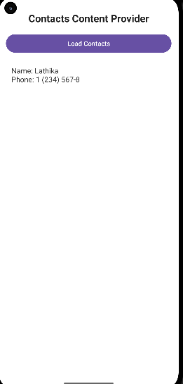

# Contacts Content Provider

 

An Android application developed using Kotlin and XML that retrieves contact names and phone numbers from the device using Android's Contacts Content Provider.

 

## Features

 

- Requests permission to read contacts at runtime.

- Retrieves contact names and phone numbers using `ContactsContract`.

- Displays the retrieved contacts in a scrollable list.

- Does not modify or delete contacts.

 

## Technologies Used

 

- Android Studio

- Kotlin

- XML

- Android Contacts Content Provider

- `ContentResolver`

 

## Permission

 

The app requires the following permission in `AndroidManifest.xml`:

 

```xml

<uses-permission android:name="android.permission.READ_CONTACTS" />

```

 

The user must grant this permission before the app can read contacts.

 

## Screenshot

 



 

## How to Run

 

1. Clone or download this repository.

2. Open the project in Android Studio.

3. Allow Gradle sync to finish.

4. Run the app on an Android device or emulator.

5. Tap **Load Contacts** and grant the contacts permission when prompted.

 

## How It Works

 

The app uses `ContentResolver` to query `ContactsContract.CommonDataKinds.Phone.CONTENT_URI`, retrieves each contact's display name and phone number, and displays the results on the screen.

 

## Package Name

 

`com.example.contactscontentprovider`
